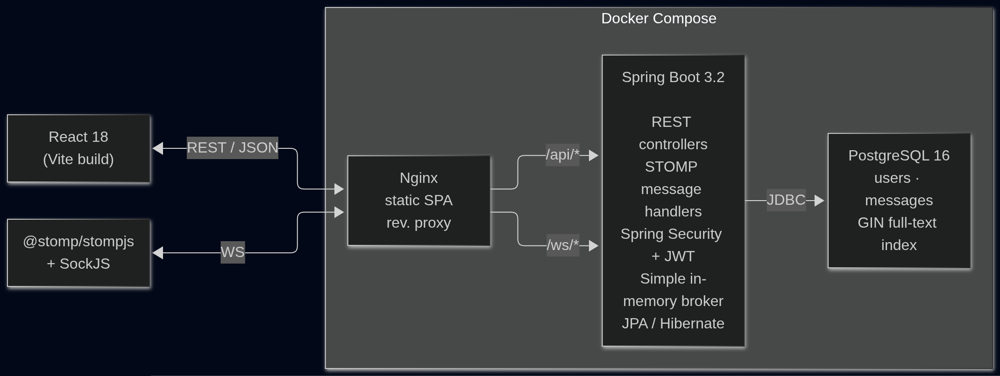
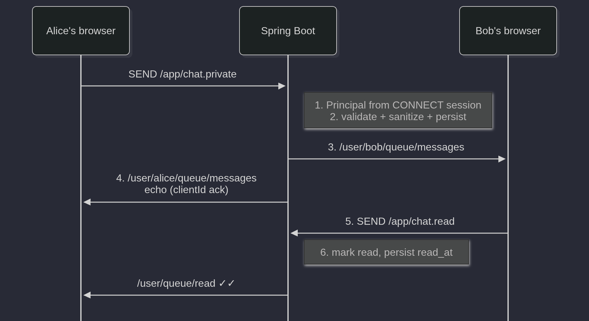
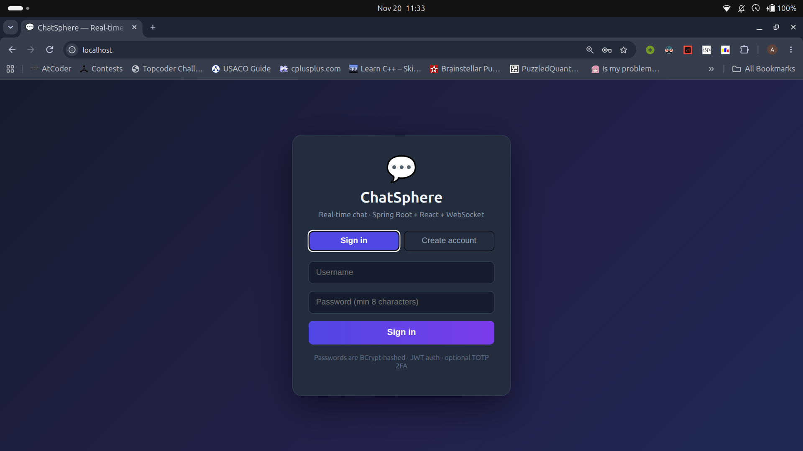
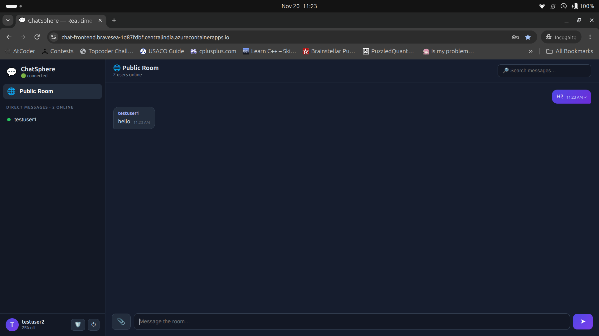
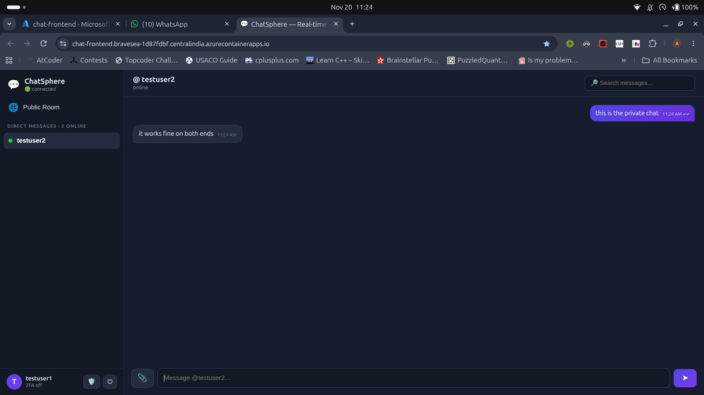
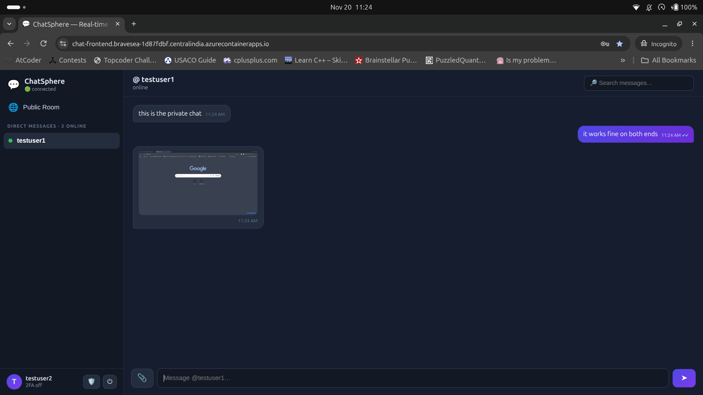
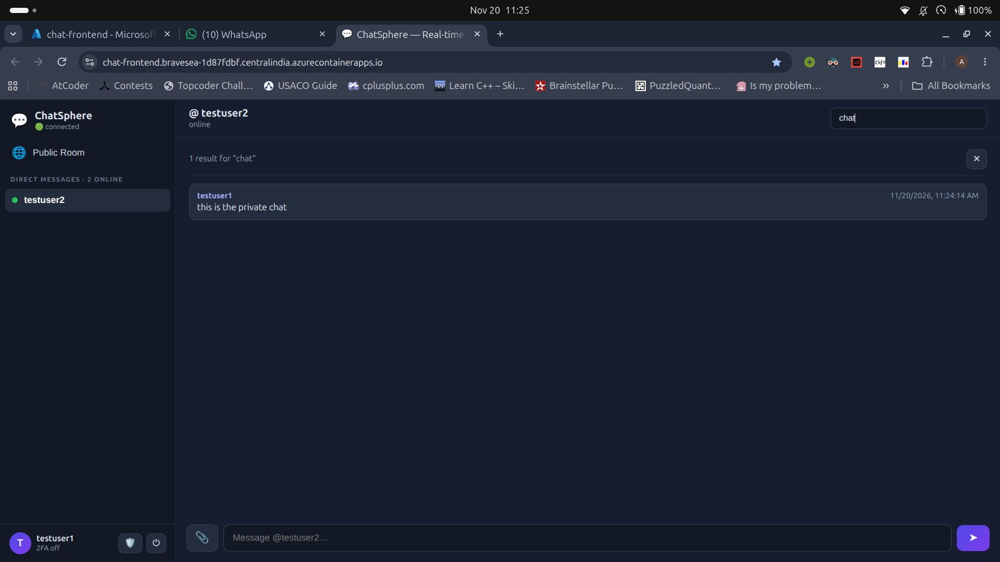
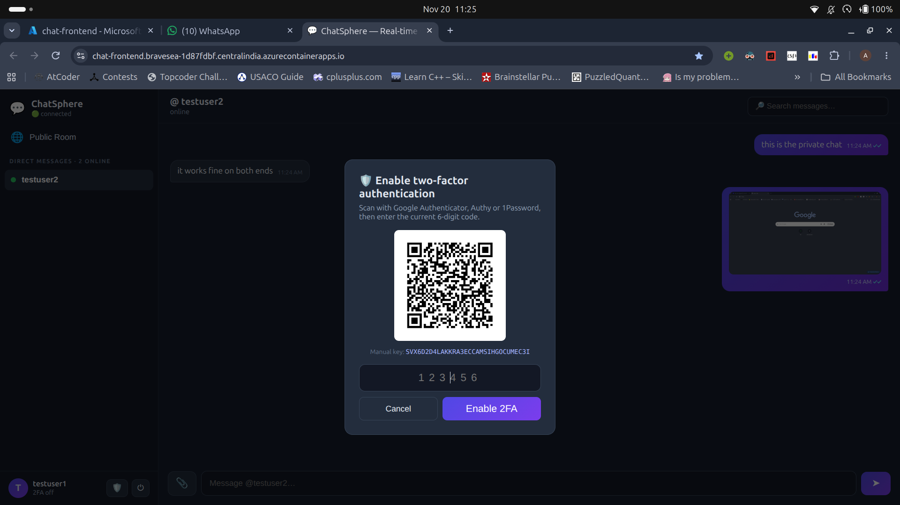

<div align="center">

# 💬 ChatSphere

**Real-time chat, engineered like production.**

Stateless JWT security · STOMP/WebSocket messaging · PostgreSQL full-text search · TOTP two-factor auth · fully containerized CI/CD


[🌐 Live Demo](https://chat-frontend.bravesea-1d87fdbf.centralindia.azurecontainerapps.io/) ·
[✨ Features](#-features) ·
[🏗️ Architecture](#-architecture) ·
[🚀 Quick Start](#-quick-start) ·
[📡 API](#-api-reference) ·
[🧪 Testing](#-testing) ·
[☁️ Deployment](#-deployment)

</div>

---

> **92.3%** line coverage (80% gate) · **53** backend tests incl. real STOMP-over-WebSocket E2E · **22**-check live smoke suite · **one-command** Docker deploy

A production-grade, full-stack real-time chat platform built to demonstrate enterprise
backend engineering: **stateless JWT security, STOMP/WebSocket messaging, PostgreSQL
full-text search, TOTP two-factor authentication, and a fully containerized CI/CD pipeline.**

---

## ✨ Features

| | Feature | Details |
|---|---------|---------|
| 🔐 | **Authentication** | Registration & login, BCrypt hashing, JWT access tokens (15 min) + refresh tokens (7 days) with strict `type` claim separation and rotation |
| 🛡️ | **Two-factor auth** | RFC 6238 TOTP with QR-code enrollment (Google Authenticator / Authy / 1Password) |
| 🌐 | **Public room** | Broadcast messaging to every connected user |
| ✉️ | **Private DMs** | 1:1 messaging with per-user STOMP queues — never leaked to other subscribers |
| 🟢 | **Presence** | Thread-safe online tracking, multi-tab aware (a user stays online until their *last* session closes) |
| 💾 | **Persistence** | Every message stored in PostgreSQL 16; history loads when you open a chat |
| ⌨️ | **Typing indicators** | Debounced (500 ms) with 2 s idle timeout and 3 s remote expiry |
| ✓✓ | **Read receipts** | ✓ sent → ✓✓ read, persisted with `read_at`, pushed to the sender in real time |
| 📎 | **File uploads** | Images & documents up to 10 MB, extension allow-list, inline image previews, UUID capability URLs |
| 🔎 | **Full-text search** | PostgreSQL `tsvector` + GIN index, scoped to the room or a private conversation |
| ⚡ | **Optimistic UI** | Messages render instantly, reconciled with the server echo via `clientId` |
| 🐳 | **One-command deploy** | `docker-compose up --build` → Postgres + backend + Nginx-served React |
| 🧪 | **Tested** | JUnit 5 unit + MockMvc + **real end-to-end STOMP-over-WebSocket tests**, JaCoCo 80% coverage gate |
| 🔁 | **CI/CD** | GitHub Actions: tests + coverage gate + frontend build + Dockerized smoke test on every push |

---

## 🏗️ Architecture

<div align="center">
  
</div>

<p align="center"><i>React 18 + Nginx + Spring Boot 3.2 + PostgreSQL 16, orchestrated by Docker Compose.</i></p>

### ✉️ Real-time message flow (private message)

<div align="center">
  
</div>

<p align="center"><i>DM delivery, sender echo, and read receipts — identity always derived from the authenticated session.</i></p>

### 🎯 Design decisions worth asking about in an interview

- **Stateless auth everywhere** — no `HttpSession`; the STOMP `CONNECT` frame carries the same
  bearer token as REST, validated by a `ChannelInterceptor` that attaches a `Principal` to the
  whole WebSocket session. Senders are *never* taken from payloads.
- **Topic-injection defense** — the interceptor only allows client `SEND` to `/app/**`, so a
  malicious client cannot publish straight into `/topic/public` and impersonate others.
- **IDOR protection** — `GET /api/messages/private/{username}?me=` accepts the legacy `me` param
  but derives identity from the JWT; passing someone else's name → `403`.
- **Token type separation** — access and refresh tokens are both JWTs but carry a `type` claim
  that every consumer checks; a refresh token can't call the API and vice versa.
- **Presence with multiple sessions** — `username → Set<sessionId>` in a `ConcurrentHashMap`
  with atomic `compute()` transitions; two tabs ≠ two users, closing one tab ≠ offline.
- **XSS defense in depth** — content is HTML-escaped server-side before persistence; React
  escapes again on render. Attachment URLs must match the server-minted `/api/files/{uuid}.{ext}`
  pattern — no foreign URLs accepted.
- **Capability URLs for files** — downloads are unauthenticated but unguessable (UUID v4 names),
  so `` works without headers while enumeration is infeasible.

---

## 🧰 Tech Stack

| Layer | Technology | Version |
|-------|-----------|---------|
| Backend framework | Spring Boot | 3.2.0 |
| Language | Java | 17 |
| Security | Spring Security + jjwt | 0.12.6 |
| Database | PostgreSQL | 16 |
| ORM | Spring Data JPA / Hibernate | via Boot |
| Real-time | WebSocket + STOMP + SockJS (simple in-memory broker) | via Boot |
| 2FA | dev.samstevens.totp | 1.7.1 ¹ |
| Frontend | React | 18.2 |
| Build tool | Vite | 5.0 |
| WS client | @stomp/stompjs + sockjs-client | 7.0 / 1.6 |
| Containers | Docker + Docker Compose (multi-stage builds) | latest |
| CI/CD | GitHub Actions | — |
| Cloud | Azure Container Apps + Azure Database for PostgreSQL | — |
| Testing | JUnit 5, Mockito, MockMvc, H2, JaCoCo | — |

> ¹ *The brief specified totp 1.9, but 1.7.1 is the latest release published to Maven Central — the build uses the real artifact.*

---

## 🚀 Quick Start

### 🐳 Docker — one command

```bash
git clone https://github.com/A-K-2006/chat-app.git
cd chat-app
docker-compose up --build
```

Open **http://localhost** — register two users in two browser windows and chat.

| Service | URL |
|---------|-----|
| Frontend (Nginx) | http://localhost |
| API (also proxied at `/api`) | http://localhost:8080 |
| Health | http://localhost:8080/actuator/health |

Compose ships with **dev-only defaults** so it truly runs with one command.
For anything beyond localhost:

```bash
cp .env.example .env
openssl rand -base64 48   # paste into JWT_SECRET
```

Stop / wipe:

```bash
docker-compose down        # keep data
docker-compose down -v     # also delete DB + uploads
```

### 🔧 Manual setup (development)

<details>
<summary>Prerequisites: JDK 17 · Maven 3.8+ · Node 20+ · PostgreSQL 16 (or Docker for just the DB)</summary>

```bash
# 1. Database
docker run -d --name chat-pg -p 5432:5432 \
  -e POSTGRES_DB=chatdb -e POSTGRES_USER=chat -e POSTGRES_PASSWORD=chatpass \
  postgres:16-alpine

# 2. Backend  (JWT_SECRET is REQUIRED and must be 32+ chars)
cd backend
export JWT_SECRET="$(openssl rand -base64 48)"
mvn spring-boot:run          # http://localhost:8080

# 3. Frontend  (Vite proxies /api and /ws to :8080 — no CORS setup needed)
cd ../frontend
npm install
npm run dev                  # http://localhost:5173
```

</details>

---

## 📡 API Reference

<details>
<summary>📖 Expand the full REST + STOMP contract</summary>

### REST

All endpoints return JSON. Authenticated routes require `Authorization: Bearer <accessToken>`.
Errors are uniform: `{"error": "human-readable message"}`.

#### Auth

| Method | Path | Body | Success | Notes |
|--------|------|------|---------|-------|
| POST | `/api/auth/register` | `{username, password}` | `201` + token pair | username 3–30 `[a-zA-Z0-9_]`, password 8–72 |
| POST | `/api/auth/login` | `{username, password, twoFactorCode?}` | `200` + token pair | `401 {"error":"2FA_REQUIRED"}` when a TOTP code is needed |
| POST | `/api/auth/refresh` | `{refreshToken}` | `200` + **rotated** pair | access tokens are rejected here (`type` claim) |
| POST | `/api/auth/2fa/setup` | — | `200 {secret, qrCodeDataUri}` | 🔒 secret stored, 2FA *not yet* enabled |
| POST | `/api/auth/2fa/verify` | `{code}` | `200 {twoFactorEnabled:true}` | 🔒 proves possession before enabling |

Token response shape:

```json
{
  "accessToken": "eyJ…", "refreshToken": "eyJ…",
  "tokenType": "Bearer", "expiresIn": 900,
  "username": "alice", "twoFactorEnabled": false
}
```

#### Messages

| Method | Path | Success | Notes |
|--------|------|---------|-------|
| GET | `/api/messages/public?limit=100` | `200 [MessageDto]` | 🔒 oldest-first, max 100 |
| GET | `/api/messages/private/{username}?me={me}` | `200 [MessageDto]` | 🔒 identity from JWT; spoofed `me` → `403` |
| GET | `/api/messages/search?q={query}` | `200 [MessageDto]` | 🔒 PostgreSQL FTS, public room |
| GET | `/api/messages/search/private/{username}?q={query}` | `200 [MessageDto]` | 🔒 FTS scoped to your conversation |

`MessageDto`:

```json
{
  "id": 42, "sender": "alice", "receiver": "bob",
  "content": "hello", "timestamp": "2026-11-20T08:30:00Z",
  "isPrivate": true, "isRead": false, "readAt": null,
  "fileType": null, "fileName": null, "fileUrl": null,
  "clientId": "b3f1…"
}
```

#### Files

| Method | Path | Body | Success | Notes |
|--------|------|------|---------|-------|
| POST | `/api/files/upload` | multipart `file` | `201 {fileUrl, fileName, fileType, size}` | 🔒 ≤10 MB; jpg/png/gif/webp/pdf/txt/md/doc(x)/xls(x)/csv/ppt(x)/zip |
| GET | `/api/files/{filename}` | — | `200` binary | public capability URL (UUID name); images render inline |

### WebSocket (STOMP over SockJS)

Endpoint: **`/ws`** (SockJS). The `CONNECT` frame must carry:

```
Authorization: Bearer <accessToken>
```

Invalid token → STOMP `ERROR` frame, connection refused. Clients may only `SEND` to `/app/**`
and subscribe to `/topic/**` or their own `/user/queue/**`.

#### Client → Server

| Destination | Payload | Effect |
|-------------|---------|--------|
| `/app/chat.send` | `{content, clientId?, fileType?, fileName?, fileUrl?}` | persist + broadcast to `/topic/public` |
| `/app/chat.private` | `{receiver, content, clientId?, …attachment}` | persist + deliver to receiver **and** sender echo |
| `/app/chat.typing` | `{receiver, typing}` | `receiver:null` → `/topic/typing`; else receiver's queue |
| `/app/chat.read` | `{messageId}` | mark read + notify sender |

#### Server → Client (subscriptions)

| Destination | Payload | When |
|-------------|---------|------|
| `/topic/public` | `MessageDto` | any public message |
| `/topic/users` | `["alice","bob"]` | presence changes + snapshot on subscribe |
| `/topic/typing` | `{sender, receiver:null, typing}` | public-room typing |
| `/user/queue/messages` | `MessageDto` | your DMs (incl. sender echo) |
| `/user/queue/typing` | `{sender, receiver, typing}` | someone typing to you |
| `/user/queue/read` | `{messageId, reader, readAt}` | your message was read |
| `/user/queue/errors` | `{error}` | your frame was rejected |

</details>

---

## 🗄️ Database Schema

Hibernate manages the DDL (`ddl-auto=update`); `data.sql` adds the search indexes idempotently
after startup. Search uses `plainto_tsquery` (safe for arbitrary user input) with the exact
expression the GIN index was built on, so the planner uses the index.

<details>
<summary>🧾 Logical schema (SQL)</summary>

```sql
CREATE TABLE users (
    id BIGSERIAL PRIMARY KEY,
    username VARCHAR(30) UNIQUE NOT NULL,
    password VARCHAR(255) NOT NULL,          -- BCrypt hash
    two_factor_secret VARCHAR(255),
    two_factor_enabled BOOLEAN NOT NULL DEFAULT FALSE
);

CREATE TABLE messages (
    id BIGSERIAL PRIMARY KEY,
    sender VARCHAR(30) NOT NULL,
    receiver VARCHAR(30),                    -- NULL = public room
    content TEXT,                            -- HTML-escaped
    timestamp TIMESTAMPTZ NOT NULL,
    is_private BOOLEAN NOT NULL,
    is_read BOOLEAN NOT NULL DEFAULT FALSE,
    read_at TIMESTAMPTZ,
    file_type VARCHAR(50),                   -- 'IMAGE' | 'FILE' | NULL
    file_name VARCHAR(255),
    file_url VARCHAR(500)
);

-- Full-text search (created by data.sql)
CREATE INDEX IF NOT EXISTS idx_messages_content_fts
    ON messages USING GIN (to_tsvector('english', coalesce(content, '')));
```

</details>

---

## 🧪 Testing

```bash
cd backend
mvn verify          # compile + all tests + JaCoCo report + 80% line-coverage gate
```

📊 Report: `backend/target/site/jacoco/index.html` — measured line coverage: **92.3%** (gate: 80%).

| Suite | Style | What it proves |
|-------|-------|----------------|
| `AuthControllerTest` | MockMvc + H2 | register/duplicate/login/invalid creds/refresh rotation/type enforcement/validation + **full 2FA enrollment & login flow** |
| `MessageServiceTest` | Mockito unit | sanitization, public/private saves, history ordering & caps, read-receipt authorization & idempotency, attachment validation |
| `MessageRestControllerTest` | MockMvc + H2 | history auth, conversation scoping, **IDOR (`me` spoofing) → 403** |
| `FileControllerTest` | MockMvc | upload/download round-trip, auth, extension allow-list, 10 MB limit, path traversal |
| `ChatWebSocketIntegrationTest` | **real server, random port, real STOMP client** | CONNECT auth rejection, public broadcast, DM privacy (eavesdropper gets nothing), typing, read receipts, presence connect/disconnect, **topic-injection blocked**, personal error queue |
| `JwtUtilTest` | unit | expiry, tampering, foreign keys, type separation, fail-fast short secret |
| `OnlineUserServiceTest` | unit | multi-session transitions + 8-thread concurrency hammer |
| `TwoFactorServiceTest` | unit | secret format, QR data URI, code verification |

Tests run on H2 (PostgreSQL mode); the PostgreSQL-only `tsvector` search is additionally
exercised by the Dockerized CI smoke test and the live smoke script:

```bash
# Against a running stack (backend :8080 + local PostgreSQL, run as root):
node scripts/smoke-test.mjs
```

**22 checks:** health, register/login/refresh rotation & type enforcement, file upload/download +
extension rejection, **real `tsvector` full-text search incl. english stemming and private-message
isolation**, IDOR guard, and the full 2FA flow verified with an *independently implemented* Node
TOTP client.

---

## 📸 Screenshots

| Login & 2FA | Public room | Private chat + receipts |
|:-----------:|:-----------:|:-----------------------:|
|  |  |  |

| File preview | Search | 2FA setup |
|:------------:|:------:|:---------:|
|  |  |  |

*(placeholder paths — capture after first run and drop into `docs/screenshots/`)*

---

## 🗺️ Roadmap

- [ ] Redis-backed presence + STOMP broker relay (RabbitMQ) for horizontal scaling
- [ ] Refresh-token revocation list (logout-everywhere, reuse detection)
- [ ] Group rooms with roles & moderation
- [ ] Message reactions, replies/threads, pagination cursors
- [ ] Rate limiting (Bucket4j) on auth + STOMP frames
- [ ] S3-compatible object storage for uploads
- [ ] End-to-end encryption for DMs (Web Crypto)
- [ ] OpenTelemetry tracing + Grafana dashboards
- [ ] Playwright E2E suite for the frontend

---

## 📂 Project Structure

<details>
<summary>🌲 Expand the repository tree</summary>

```
chat-app/
├── backend/                  # Spring Boot 3.2 (Java 17)
│   ├── src/main/java/com/example/chat/
│   │   ├── config/           # Security + WebSocket configuration
│   │   ├── controller/       # REST + STOMP handlers
│   │   ├── dto/              # Java 17 records (wire contracts)
│   │   ├── entity/           # JPA entities
│   │   ├── exception/        # uniform JSON error handling
│   │   ├── listener/         # presence lifecycle events
│   │   ├── model/            # TypingEvent
│   │   ├── repository/       # Spring Data JPA (+ native FTS)
│   │   ├── security/         # JWT util/filters, STOMP interceptor
│   │   └── service/          # business logic
│   ├── src/test/java/        # 53 tests incl. real-WebSocket E2E
│   └── Dockerfile            # multi-stage: Maven → temurin JRE alpine
├── frontend/                 # React 18 + Vite 5
│   ├── src/                  # App (auth/refresh), Chat (realtime UI), api
│   ├── nginx.conf            # SPA + /api + /ws reverse proxy
│   └── Dockerfile            # multi-stage: Node → Nginx alpine
├── docs/screenshots/         # UI captures + rendered architecture diagrams
├── .github/workflows/ci.yml  # test + coverage gate + docker smoke test
├── scripts/smoke-test.mjs    # 22-check live API smoke test (real PostgreSQL)
├── docker-compose.yml        # postgres + backend + frontend
├── .env.example
└── CONTRIBUTING.md
```

</details>

## ☁️ Deployment

ChatSphere is deployed on **Azure Container Apps** with **Azure Database for PostgreSQL Flexible Server**.
👉 **[Live demo](https://chat-frontend.bravesea-1d87fdbf.centralindia.azurecontainerapps.io/)**

> ⚠️ It's a public demo and registration is open — please don't use a real password.

```
Browser ──► chat-frontend (Nginx, public)
                │  /api/*  and  /ws/*  proxied over HTTPS
                ▼
            chat-backend (Spring Boot, 1 replica)
                │  JDBC (SSL)
                ▼
            PostgreSQL Flexible Server  (database: chatdb)
```

### 📌 Things to know

| # | Constraint | Why |
|---|------------|-----|
| 1 | Backend runs **exactly one replica** | The STOMP broker and online-user list are in memory and not shared between instances (see [Scaling path](#-scaling-path)) |
| 2 | Uploaded files are **ephemeral** | They live on the container disk and disappear on restart |
| 3 | Nginx must proxy to the backend's **full hostname** | In Container Apps "Express" mode the short name `chat-backend` doesn't resolve from Nginx, and the backend ingress must be **external** (otherwise Azure answers `{"error":"Not found"}`) |
| 4 | `frontend/nginx.conf` differs on Azure | The repo file proxies to `backend:8080` (docker-compose). The deploy step swaps it temporarily, builds, then restores it |
| 5 | `chatdb` is **not** auto-created | Forgetting it crashes the backend with `FATAL: database "chatdb" does not exist` |
| 6 | Backend is publicly reachable | External ingress is required here; it's protected by JWT auth and CORS, not by network isolation — a known trade-off |

<details>
<summary>🧭 Step-by-step manual deployment (Azure CLI)</summary>

Run each block **one at a time** from the project root (the folder containing `backend/` and `frontend/`) and check the *Expect* line before moving on.

#### 0 · Login

```bash
az login
az account show --query name -o tsv
az account set --subscription "<name or id>"   # only if you have several
```

#### 1 · Variables

`ACR` and `PG` must be globally unique, lowercase, letters and digits only. Don't use `$RANDOM` (a new terminal would give a different value).

```bash
RG=chat-rg
LOC=centralindia
ACR=<unique-registry-name>
PG=<unique-server-name>
DBUSER=chatadmin
DBPASS='<strong-password>'
JWT="$(openssl rand -base64 48)"   # 32+ chars
```

Password rules: upper + lower case + digits, 12+ characters, and avoid `@ : / ? # & " '` and spaces.
💡 Keep these lines in a `vars.sh`, add it to `.gitignore`, and `source vars.sh` in new terminals. **Never commit it.**

#### 2 · Extension and providers

```bash
az extension add --name containerapp --upgrade
az provider register --namespace Microsoft.App
az provider register --namespace Microsoft.OperationalInsights
az provider register --namespace Microsoft.ContainerRegistry
az provider register --namespace Microsoft.DBforPostgreSQL

# repeat until all four print "Registered"
for p in Microsoft.App Microsoft.OperationalInsights Microsoft.ContainerRegistry Microsoft.DBforPostgreSQL; do
  az provider show -n $p --query registrationState -o tsv
done
```

#### 3 · Resource group

```bash
az group create -n $RG -l $LOC     # Expect: "provisioningState": "Succeeded"
```

#### 4 · Container registry + backend image

```bash
az acr create -n $ACR -g $RG --sku Basic --admin-enabled true
az acr build -r $ACR -t chat-backend:v1 ./backend    # Expect: "Run ID: ... was successful"
```

If `az acr build` is blocked on your subscription (`TasksOperationsNotAllowed`), build locally:

```bash
az acr login -n $ACR
docker build -t $ACR.azurecr.io/chat-backend:v1 ./backend
docker push $ACR.azurecr.io/chat-backend:v1
```

#### 5 · PostgreSQL server + database

```bash
PGLOC=canadacentral
az postgres flexible-server create -g $RG --name $PG -l $PGLOC \
  --admin-user $DBUSER --admin-password "$DBPASS" \
  --tier Burstable --sku-name Standard_B1ms --version 16 \
  --storage-size 32 --high-availability Disabled \
  --public-access 0.0.0.0 --yes

# do not skip: the database is not created automatically
az postgres flexible-server db create -g $RG --server-name $PG --name chatdb
az postgres flexible-server db list   -g $RG --server-name $PG -o table   # Expect: chatdb
```

Takes 5–10 minutes. `--public-access 0.0.0.0` lets Azure services (your backend) connect. Don't use `--database-name` (elastic clusters only).
If you get `SkuNotAvailable` (common on Azure for Students), change `PGLOC` and rerun — try `southindia`, `uksouth`, `centralus`, `eastus2`, `westus3`, `southeastasia`.

> 💰 If you use the portal instead, double-check the **Estimated total** on the Review page: Burstable `Standard_B1ms`, 32 GiB, HA **disabled**, version 16 ≈ USD 22/month. Portal defaults can show General Purpose / HA enabled / ~USD 600/month.

#### 6 · Container Apps environment

```bash
az containerapp env create -n chat-env -g $RG -l $LOC    # change LOC on region/quota errors
```

#### 7 · Deploy the backend

```bash
ACR_PASS=$(az acr credential show -n $ACR --query "passwords[0].value" -o tsv)
PGHOST=$(az postgres flexible-server show -g $RG --name $PG --query fullyQualifiedDomainName -o tsv)

az containerapp create -n chat-backend -g $RG --environment chat-env \
  --image $ACR.azurecr.io/chat-backend:v1 \
  --registry-server $ACR.azurecr.io --registry-username $ACR --registry-password "$ACR_PASS" \
  --target-port 8080 --ingress external \
  --cpu 0.5 --memory 1.0Gi --min-replicas 1 --max-replicas 1 \
  --secrets db-pass="$DBPASS" jwt-secret="$JWT" \
  --env-vars \
    SPRING_DATASOURCE_URL="jdbc:postgresql://$PGHOST:5432/chatdb?sslmode=require" \
    SPRING_DATASOURCE_USERNAME=$DBUSER \
    SPRING_DATASOURCE_PASSWORD=secretref:db-pass \
    JWT_SECRET=secretref:jwt-secret
```

Wait ~90 s, then verify:

```bash
az containerapp logs show -n chat-backend -g $RG --tail 80 | grep -iE "Started ChatApplication|ERROR|FATAL"
BACKEND=$(az containerapp show -n chat-backend -g $RG --query properties.configuration.ingress.fqdn -o tsv)
curl -s https://$BACKEND/actuator/health      # Expect: {"status":"UP"}
```

Environment variables: `SPRING_DATASOURCE_URL`, `SPRING_DATASOURCE_USERNAME`, `SPRING_DATASOURCE_PASSWORD`, `JWT_SECRET` (required, no default), `CORS_ALLOWED_ORIGINS`, `UPLOAD_DIR` (already `/app/uploads` in the Dockerfile).

#### 8 · Build the frontend with the Azure Nginx config

```bash
cp frontend/nginx.conf frontend/nginx.conf.local      # back up the local config

cat > frontend/nginx.conf <<'EOF'
server {
    listen 80;
    server_name _;
    root /usr/share/nginx/html;
    index index.html;
    client_max_body_size 12m;

    location / {
        try_files $uri $uri/ /index.html;
    }

    location /api/ {
        proxy_pass https://__BACKEND__;
        proxy_ssl_server_name on;
        proxy_set_header Host __BACKEND__;
        proxy_set_header X-Real-IP $remote_addr;
        proxy_set_header X-Forwarded-For $proxy_add_x_forwarded_for;
        proxy_set_header X-Forwarded-Proto $scheme;
    }

    location /ws/ {
        proxy_pass https://__BACKEND__;
        proxy_ssl_server_name on;
        proxy_http_version 1.1;
        proxy_set_header Upgrade $http_upgrade;
        proxy_set_header Connection "upgrade";
        proxy_set_header Host __BACKEND__;
        proxy_set_header X-Forwarded-For $proxy_add_x_forwarded_for;
        proxy_set_header X-Forwarded-Proto $scheme;
        proxy_read_timeout 3600s;
        proxy_send_timeout 3600s;
        proxy_buffering off;
    }

    location = /healthz {
        return 200 'ok';
        add_header Content-Type text/plain;
    }

    gzip on;
    gzip_types text/css application/javascript application/json image/svg+xml;
}
EOF

sed -i "s#__BACKEND__#$BACKEND#g" frontend/nginx.conf
grep -n "proxy_pass\|Host" frontend/nginx.conf        # Expect: your real backend hostname everywhere

az acr build -r $ACR -t chat-frontend:v1 ./frontend
mv frontend/nginx.conf.local frontend/nginx.conf      # restore the local config
```

Don't add a `resolver` directive (it causes `"resolver" directive is duplicate` because both locations share one server block), and overwrite the whole file rather than patching it with `sed`.

#### 9 · Deploy the frontend

```bash
az containerapp create -n chat-frontend -g $RG --environment chat-env \
  --image $ACR.azurecr.io/chat-frontend:v1 \
  --registry-server $ACR.azurecr.io --registry-username $ACR --registry-password "$ACR_PASS" \
  --target-port 80 --ingress external --min-replicas 1 --max-replicas 1

FQDN=$(az containerapp show -n chat-frontend -g $RG --query properties.configuration.ingress.fqdn -o tsv)
echo https://$FQDN
```

If the frontend logs show `host not found in upstream "chat-backend"`, the old short-name config is in the image — redo step 8 and rebuild with a new tag.

#### 10 · Allow the frontend origin (CORS)

```bash
az containerapp update -n chat-backend -g $RG --set-env-vars CORS_ALLOWED_ORIGINS=https://$FQDN
```

Creates a new backend revision (~60 s). The origin must match the browser URL exactly: `https://`, no trailing slash.

#### 11 · Test

```bash
curl -i -X POST https://$FQDN/api/auth/login \
  -H "Content-Type: application/json" \
  -d '{"username":"nouser","password":"wrongpass1"}'
```

Any Spring JSON error (`400`, `401` or `403`) means the whole chain works. `{"error":"Not found"}` means the backend ingress isn't external or the hostname in `nginx.conf` doesn't match:

```bash
az containerapp show -n chat-backend -g $RG --query "properties.configuration.ingress.{fqdn:fqdn,external:external}" -o json
az containerapp ingress update -n chat-backend -g $RG --type external
```

Then open `https://<FQDN>`, register two users (second browser or incognito) and try public chat, DMs, typing, read receipts, file upload and 2FA.

</details>

<details>
<summary>🔁 Redeploy after code changes</summary>

Use a **new image tag** each time so Azure pulls the new image.

```bash
# Backend
az acr build -r $ACR -t chat-backend:v2 ./backend
az containerapp update -n chat-backend -g $RG --image $ACR.azurecr.io/chat-backend:v2

# Frontend: repeat step 8 with tag v2, then
az containerapp update -n chat-frontend -g $RG --image $ACR.azurecr.io/chat-frontend:v2

# Force a restart without code changes
az containerapp update -n chat-backend -g $RG --set-env-vars RESTARTED_AT=$(date +%s)
```

</details>

<details>
<summary>🧹 Reset the database (delete all test data)</summary>

Scale the backend to zero first so the database has no open connections:

```bash
az containerapp update -n chat-backend -g $RG --min-replicas 0 --max-replicas 1
sleep 30

az postgres flexible-server db delete -g $RG --server-name $PG --name chatdb --yes
az postgres flexible-server db create -g $RG --server-name $PG --name chatdb

# Hibernate recreates the tables, data.sql recreates the full-text index
az containerapp update -n chat-backend -g $RG --min-replicas 1 --max-replicas 1 --set-env-vars RESTARTED_AT=$(date +%s)
sleep 90
az containerapp logs show -n chat-backend -g $RG --tail 60 | grep -iE "Started ChatApplication|ERROR|FATAL"
```

Uploaded files are wiped by the restart; log out or clear site data in the browser afterwards (old tokens belong to deleted users).

To delete only some rows, use the portal's Cloud Shell:

```bash
az postgres flexible-server connect -n $PG -u chatadmin -d chatdb --interactive
# then, e.g.:
#   TRUNCATE TABLE messages, users RESTART IDENTITY CASCADE;
#   DELETE FROM users WHERE username LIKE 'testuser%';
```

If you add a laptop firewall rule, remove it afterwards:

```bash
az postgres flexible-server firewall-rule create -g $RG --server-name $PG --name MyLaptop --start-ip-address <your-ip> --end-ip-address <your-ip>
az postgres flexible-server firewall-rule delete -g $RG --server-name $PG --name MyLaptop --yes
```

</details>

<details>
<summary>💸 Saving cost between demos</summary>

```bash
# Pause
az postgres flexible-server stop -g $RG --name $PG
az containerapp update -n chat-backend  -g $RG --min-replicas 0
az containerapp update -n chat-frontend -g $RG --min-replicas 0

# Resume (wait a few minutes, then open the site once)
az postgres flexible-server start -g $RG --name $PG
az containerapp update -n chat-backend  -g $RG --min-replicas 1
az containerapp update -n chat-frontend -g $RG --min-replicas 1
```

- Azure automatically restarts a stopped flexible server after 7 days — stop it again.
- A stopped database isn't billed for compute, but storage (~USD 4/month) still is.
- The database (~USD 22/month at list price) is the biggest cost, then the always-on apps. Log Analytics ingestion is billed per GB.
- Create a budget: Portal → Cost Management → Budgets (alerts at 50% / 90%).
- Tear everything down when finished: `az group delete -n $RG --yes`
- Alternative: point `SPRING_DATASOURCE_URL` / `USERNAME` / `PASSWORD` at a free external Postgres (Neon, Supabase).

</details>

<details>
<summary>🔒 Security checklist</summary>

- [ ] Never commit the DB password, JWT secret, ACR credentials or `vars.sh`.
- [ ] Rotate the DB password if it ever appeared in a chat or screenshot (Portal → server → *Reset password*), then:
  ```bash
  az containerapp secret set -n chat-backend -g $RG --secrets db-pass='NEWPASS'
  az containerapp update -n chat-backend -g $RG --set-env-vars RESTARTED_AT=$(date +%s)
  ```
- [ ] Never add the firewall rule `0.0.0.0–255.255.255.255` (opens the DB to the whole internet). Only the `0.0.0.0` "Azure services" rule is needed.
- [ ] Remove your laptop-IP firewall rule when you're done inspecting data.
- [ ] The frontend URL is meant to be public; the backend URL isn't secret but is protected only by JWT and CORS.
- [ ] Run `history -c` if you typed a password directly into a command.
- [ ] Registration is open — tell visitors not to use real passwords on the demo.

</details>

<details>
<summary>🩺 Troubleshooting</summary>

| Symptom | Cause / fix |
|---------|-------------|
| `No extension found 'containerapps'` | The name is `containerapp` (singular) |
| `--database-name only for elastic cluster` | Remove it; create the DB separately |
| `SkuNotAvailable` / offer restricted | Try another `PGLOC` region |
| `db create: --name required` | Use `--server-name` and `--name` |
| `FATAL: database "chatdb" does not exist` | Create it (step 5), then restart the app |
| `password authentication failed` | The secret differs from the real password: `az containerapp secret set … db-pass='REAL'`, then force a new revision |
| `connection timed out` | Missing firewall rule: create `AllowAzure` with start/end IP `0.0.0.0` |
| `Unable to determine Dialect without JDBC metadata` | Only a symptom of a failed DB connection — look for the `FATAL` line above it |
| Revision restart not supported (Express) | Change an env var (e.g. `RESTARTED_AT`) to force a new revision |
| `az containerapp stop/start` not found | Use `--min-replicas 0` / `1` instead |
| `host not found in upstream "chat-backend"` | Use the full backend FQDN in `nginx.conf` |
| `"resolver" directive is duplicate` | Remove the `resolver` lines |
| `{"error":"Not found"}` through the frontend | Backend ingress must be external and the Nginx hostname must match |
| CORS errors in the browser | `CORS_ALLOWED_ORIGINS` must match the browser URL exactly |
| Files vanish after restart | Expected (ephemeral disk) |

> Newer Azure CLI versions use `--server-name` (server) and `--name` (database or rule); the old `-d` / `-n` shortcuts don't work for these commands, and `az postgres flexible-server execute` isn't available.

</details>

### 📈 Scaling path

**Why one replica today:** in-memory STOMP broker, in-memory online users, and local-disk uploads.

| Stage | Work |
|-------|------|
| 1 | Azure Blob Storage for uploads, keyset pagination, composite indexes `(receiver, sender, timestamp)` |
| 2 | Redis for presence (TTL heartbeats) and rate limiting |
| 3 | RabbitMQ (STOMP plugin) with `enableStompBrokerRelay("/topic", "/queue")` so 2+ backend replicas share messages |
| 4 | Autoscaling rules, client reconnect with backoff, observability (Micrometer, OpenTelemetry), k6 WebSocket load tests |
| 5 | Read replicas, monthly table partitioning, dedicated search (OpenSearch) if `tsvector` gets slow |

Also planned: refresh-token revocation, rate limiting on login/register/uploads, and Azure Front Door or a CDN in front.

---

---

<div align="center">

## 👤 Author

**Aryan Kumar**

[](https://github.com/A-K-2006)
[](https://www.linkedin.com/in/aryan-kumar-62a738315/)
[](mailto:akaryankumar0001@gmail.com)

Built as a portfolio project to demonstrate production backend practices.
Contributions welcome — see [CONTRIBUTING.md](CONTRIBUTING.md).

## 📄 License

MIT — do whatever, just don't blame me.

---

⭐ *If this project helped you, consider giving it a star!*

[⬆ Back to top](#-chatsphere)

</div>